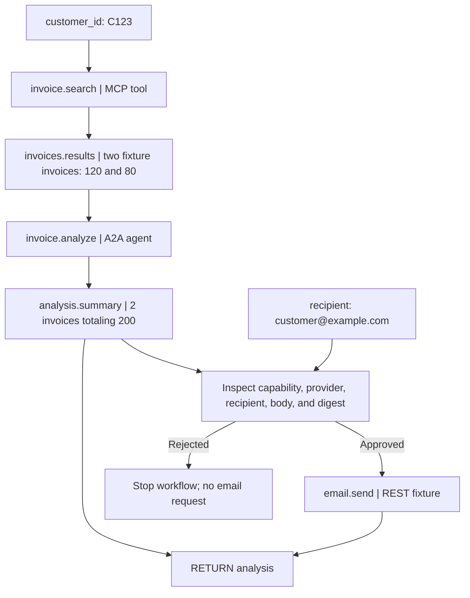
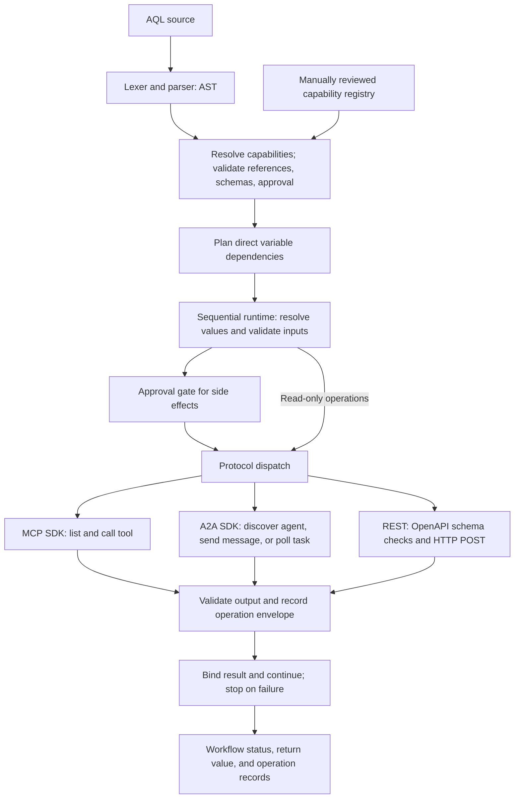

# AQL - Agent Query Language

**Describe the workflow. Compose capabilities across protocols.**

AQL is an open-source research prototype for expressing workflows over capabilities exposed through **MCP**, **Agent2Agent (A2A)**, and **OpenAPI-described REST APIs**. It combines a small declarative language, explicit capability mappings, schema validation, and an execution runtime.

**Status:** early local prototype with one working invoice workflow and simulated services. It is not a production security boundary or an industry standard. Interoperability beyond the supplied fixtures, semantic equivalence, productivity gains, and performance advantages have not been established.

## Our motivation

A single application may need to find data through an MCP tool, delegate analysis to an A2A agent, and perform an action through a REST API. Each interface has its own invocation and lifecycle details.

Our goal is to let developers describe **which capabilities a workflow needs and how data moves between them**, while explicit provider bindings and protocol adapters handle invocation. Input/output contracts, side effects, and approval should remain visible throughout that process.

AQL sits above the underlying protocols. Similar capability names do not establish equivalent business meaning; mappings require review. The research question is whether declarative composition can improve integration effort and provider portability while preserving execution behavior. That remains a hypothesis to evaluate.

## A workflow in AQL

```aql
LET invoices = INVOKE 'invoice.search'
  WITH customer_id = 'C123';

LET analysis = INVOKE 'invoice.analyze'
  WITH invoices = invoices.results;

INVOKE 'email.send'
  WITH recipient = 'customer@example.com',
       body = analysis.summary
  REQUIRE APPROVAL;

RETURN analysis;
```

`LET` binds an operation's output, `INVOKE` selects a capability, `WITH` supplies arguments, `REQUIRE APPROVAL` marks an approval-gated action, and `RETURN` selects the workflow result.

## Data flow



The mock email endpoint records acceptance; **no real email is sent**. Rejection stops execution before the REST call, so the final `RETURN` is not reached.

## Quick start

Requires **Node.js 22+** and **pnpm**. From the repository directory:

```sh
pnpm install
pnpm typecheck
pnpm test
pnpm aql run examples/invoice.aql
```

The CLI starts local A2A and REST fixtures on loopback addresses and launches the MCP fixture over stdio. Run only with trusted local fixtures. Dependencies are locked in `pnpm-lock.yaml`.

At the approval prompt, inspect the exact action and enter `y` to allow the simulated email. Any other answer rejects it. Noninteractive terminals reject by default; rejection produces a failed workflow status and a nonzero CLI exit code.

After approval, the returned value is:

```json
{
  "summary": "2 invoices totaling 200"
}
```

The full CLI response also includes the workflow status and operation envelopes with invocation IDs, capability/provider IDs, protocol, status, output or error, duration, and evidence. A rejected operation has status `rejected`; the overall workflow has status `failed`.

## Execution architecture



The dependency graph records data dependencies; execution follows source order. Provider selection uses the lexicographically first provider ID among matching registry entries. Adapters are bound to the supplied fixture operations, so adding a registry entry alone does not add a new integration.

Before a side effect, the runtime requests approval for the capability, provider, and resolved arguments, with a SHA-256 digest. This is an in-process approval mechanism; it does not authenticate the endpoint or provide durable authorization.

## Implemented scope

| Area | Current behavior |
| --- | --- |
| Language | Immutable variables, invocations, scalar literals, field references, approval, and final return |
| Validation | Capability lookup, reference checks, required/unknown arguments, limited static type checks, and runtime JSON Schema validation |
| MCP | Official TypeScript SDK over stdio; tool listing and invocation |
| A2A | Official SDK with a local 1.0 JSON-RPC fixture; message results and client task-polling branches |
| REST | Fixture operation mapped from the included OpenAPI document; request/response schema checks |
| Execution | Sequential execution, operation records, stop on failure or rejection, no automatic retries |
| Approval | Exact argument display and digest for the simulated email action |

There are no loops, conditionals, structured literals, parallel execution, transactions, or user-defined functions. Authentication, secret management, remote endpoint allowlisting, persistent audit, and multi-tenant isolation are not implemented. Timeout coverage is incomplete for MCP connection and A2A discovery; remote side effects cannot reliably be undone after a timeout. A2A task branches still need independent task-producing-agent and conformance testing.

See the [language specification](docs/specification.md), [architecture](docs/architecture.md), and [limitations](docs/limitations.md) for details.

## Research manuscript

Read **[AQL: A Declarative Query Language for Unified Discovery and Execution of Heterogeneous AI Capabilities](docs/AQL_Research_Manuscript.pdf)** (17 November 2026).

The manuscript presents the conceptual design, capability model, safety goals, research questions, and a proposed evaluation against direct SDK integration and workflow orchestration baselines. It is a research manuscript, not a report of experimentally verified improvements.

**Relationship to the implementation:** the manuscript describes implementation as future work. This repository now contains a limited executable vertical slice of that proposal. Broader registry ingestion, authorization, lifecycle guarantees, provider substitution, and comparative evaluation remain research and engineering work. Use the implementation documentation for current behavior; the manuscript's grammar and result-envelope examples are illustrative. The original PDF is included unchanged.

## Evaluation

```sh
pnpm bench
```

This exploratory microbenchmark measures **local parsing, validation, and planning only**, with 100 warmups and 1,000 samples reporting median and p95. It excludes service startup, networking, protocol execution, user approval, and developer effort. It provides no evidence of end-to-end superiority or reduced integration effort.

The proposed next step is a controlled comparison using equivalent services and failure behavior, measuring correctness, developer effort, portability, policy failures, latency, and resource use. See [benchmark methodology](docs/benchmark-methodology.md).

## Repository guide

```text
src/
  language/     AST, parser, and validator
  registry/     Explicit capability-to-provider mappings
  planner/      Variable dependency graph
  runtime/      Sequential execution and approval
  adapters/     MCP, A2A, and REST clients
  cli/          Local workflow runner
fixtures/       Local MCP server, A2A agent, and REST service
examples/       Runnable invoice workflow
tests/          Language, integration, approval, failure, and timeout checks
docs/           Specifications, limitations, methodology, and research manuscript
bench.ts        Local language-processing microbenchmark
```

## Contributing

Contributions that make behavior clearer and easier to reproduce are welcome. Useful directions include stronger schema compatibility checks, task lifecycle tests, bounded cancellation, reviewed provider mappings, and reproducible baseline workloads.

For a change, describe the behavior being improved, include a small reproducible example, update relevant documentation, and run `pnpm typecheck` and `pnpm test`. Keep proposed features and research hypotheses distinct from implemented behavior and measured results. Use synthetic fixture data and keep credentials and private payloads out of contributions.

## License

Released under the [MIT License](LICENSE). Copyright (c) 2026 AQL contributors.
