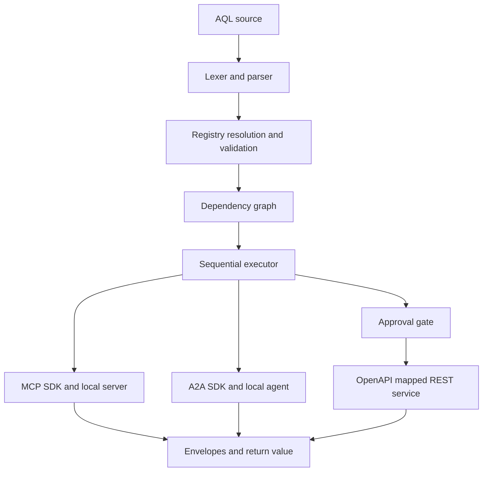

# Architecture

The registry contains manually reviewed mappings; the lexicographically first provider ID wins. The fixture A2A SDK serves an Agent Card and a JSON-RPC 1.0 interface and returns a message; the client also handles terminal tasks and polls working/submitted tasks. MCP uses a child-process stdio transport and tools/list then tools/call. REST derives request and response schemas and operation ID from the included OpenAPI file. Evidence is local runtime metadata, not cryptographically authenticated provider attestation.
